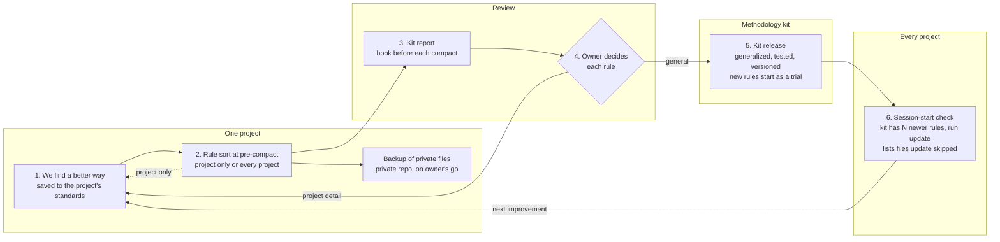

# Working Methodology Kit

One developer's way of building software with Claude Code, packaged so any new or existing project starts from
the latest version of it, and every improvement a project makes can flow back in.

It holds the rules (how decisions are made and locked, test-first, test integrity, reviews, security, git and
release discipline), the session system that keeps long AI-assisted work from drifting (tracking files, the
orientation protocol, pre-compact closeout), the agent-team build method, the skills, the tools, and the owner's
working style as memory.

**The kit stays local.** It lives in each project's working folder, ready to use and continue, but never in that
project's repo unless the owner tracks a chosen file on purpose to show growth. The install keeps every kit path
out of git in the folder's own `.git/info/exclude`, and a strict check runs before the first push to a remote
(rule:kit-stays-local, rule:first-push-gate).

## How a new rule travels



**Safeguards:** one home per rule (notes hold pointers) - each release merges and retires old rules under a size cap - a slip that repeats becomes a hook or a test - agent briefs pull the rules from one source file - a new rule is a trial until a second project uses it cleanly.

The full map, with the three places a rule can live and the skills by situation: [docs/rule-flow.html](docs/rule-flow.html).

## What is in it

| Folder / file | Installs to | What it is |
|---|---|---|
| `user/CLAUDE.md` | `~/.claude/CLAUDE.md` | Global rules for every project. `{{OWNER_NAME}}` and `{{OWNER_PROFILE}}` are filled at install. |
| `user/agents/` | `~/.claude/agents/` | Agent roles: builder, checker, orchestrator, scanner. |
| `user/skills/` | `~/.claude/skills/` | agent-team-build, teacher, teacher-sync, human-factor, methodology-kit; the format skills (pr-body, release-notes, closeout, preview-test, pre-pr-sweep, adr), each with its steps, examples and audit; and the builder and checker rules preloaded by their roles. |
| `rules/` | - | The rules themselves: a core and one module per kind of work, tool-neutral Markdown. The only place a rule is edited. |
| `project/` | the project folder | `AGENTS.md`, `standards/` and `.claude/rules/` (written by `kit.mjs build` from `rules/`), `_Start Here.md`, `_Loop Learnings.md`, `CLAUDE.md`, the four tracking files, `_Templates/`, `.claude/` tools, hooks and settings, and the skills-by-case map (`.claude/kit/skill-cases.json`). |
| `memory/` | `~/.claude/projects/<project>/memory/` | The owner's working style as subject files, with `MEMORY.md` as the index. |
| `NEW-PROJECT.md` | - | Entry point for a project that starts from nothing. |
| `EXISTING-PROJECT.md` | - | Entry point for a project that already exists: orient, map, find gaps, then adopt. |
| `THIRD-PARTY.md` | - | The plugins and skills the kit uses, their makers and licenses, and how to restore them. |
| `vendor/` | - | A credited backup copy of each third-party plugin and skill, with `CREDITS.md`. |
| `scripts/kit.mjs` | - | The one tool: install, fold-back, bump, snapshot, restore, scrub, build, measure, find, and the hook reports. Tests in `tests/`. |
| `docs/` | - | The plan record, the recall and lookup tests, and the 1.0.0 migration record (ledger, IDs, reworded lines). |
| `TRIALS.md` | - | New rules on trial, until a second project uses them cleanly. |
| `kit.config.json` | - | The owner's name (the one settings line), the size caps, retired files and the third-party backup list. |
| `owner-profile.md` | - | A few lines about the owner, placed into the global rules. |

Every rule says "the owner". The name lives only in `kit.config.json`.

## Use it

Needs Node 20 or later and git. From a Claude Code session, say "/methodology-kit new" or "/methodology-kit
existing" (after the first `install user`), or follow the entry-point files by hand.

```bash
node scripts/kit.mjs install user
```

```bash
node scripts/kit.mjs install project "<project folder>"
```

Add `--dry-run` to see what would change first. Add `--force` to replace files that differ from the kit; the
old copies are kept in a dated `kit-backups` folder next to the install record. Use it once, when a machine or
project adopts the kit for the first time, after reading the dry run.

## How the rules are organized

The core rules load in every session through `AGENTS.md`, which any AI coding tool reads and `CLAUDE.md`
imports. Everything else sits in a module that loads when the work needs it: Claude Code loads a file module
(`.claude/rules/`) by itself when a matching file is opened, and any session reads an on-demand module
(`standards/`) at the moment the core's Rule Modules table names. Every rule has a fixed ID after its heading;
a pointer is written `rule:<id>`, and `standards/INDEX.md` lists each ID, its file and the other words people
use for it.

| Task | Steps | What catches a missed step |
|---|---|---|
| Add a rule | `node scripts/kit.mjs find <words>` to pick its module; add the heading with an `{#id}`, a why, and tags in the module's frontmatter; run `node scripts/kit.mjs build` | ID, why, tags and link tests; the build-freshness test |
| Add a module | A new `rules/<id>.md` with `id`, `load` (always, files or on-demand), `paths` for a file module, `when` and `tags`; run build | Module size cap; build-freshness test |
| Grow past a cap | Merge and retire inside that one module | The size test names the module |
| Add a tool | One more output in `build` that writes that tool's files, naming the docs it follows | Build-freshness test; the release re-check (rule:kit-standards #11) |
| Release | `node scripts/kit.mjs measure`, then note the session-start bytes in the CHANGELOG | The session-start cap test |

## What runs on its own

Every project the kit installs gets these, wired in `.claude/settings.json`, so none of them depends on anyone
remembering (rule:kit-standards):

- **At session start:** fetches the kit's GitHub repo and says if it is ahead of the kit folder, says when the kit has newer rules and how many, lists kit files this project changed
  (update leaves them alone), and lists the skills for this project's cases. Claude and the owner both see it.
- **On each message:** if another project released a kit update while this session runs, says so once per new
  version, so a project running in parallel never works for hours on old rules. It adds about 0.15 s.
- **Before each compact:** counts the rule changes waiting for the kit, backs up the private vault to its own git
  repository (a local commit; the push waits for the owner), and flags third-party plugins that moved past their
  backup.
- **Before any push:** the push guard asks the owner first.

The kit's tests also hold the kit itself to its rules: every backup credited, every skill in the case map real,
briefs pointing to one rules block, memory pointing instead of repeating, a why in every rule section, every
pointer resolving to a real rule ID, the written-out files matching a fresh build, and the size caps.

## Update pipeline

Methods change. The kit is the single source, and changes move both ways:

**Kit -> projects.** Each install records the kit version and a hash of every file it wrote
(`~/.claude/kit-install.json`, `<project>/.kit/kit-version.json`). Running `install` again updates every file
the project left alone and skips, with a reason, every file it changed. A new project always starts from the
latest kit; an existing one catches up with one command.

**Project -> kit (fold-back).** When a project improves a rule, a skill or a memory:

1. `node scripts/kit.mjs fold-back project "<project folder>"` (or `fold-back user` for `~/.claude`). It sorts
   each file into fold back (changed in the project), update (changed in the kit), conflict (both), new (a file
   the kit has never seen, such as a fresh memory or skill) and missing, and writes a report with the diffs to
   `reports/`.
2. The owner picks what is general enough for the kit. Claude writes it in `rules/`, generalized, then runs
   `node scripts/kit.mjs build`. A project still on one standards file is compared section by section; the report
   names the kit rule ID for each changed section.
3. `node --test tests/kit.test.mjs` and `node scripts/kit.mjs scrub` must both pass.
4. Merge and retire before the bump. A new rule goes in as a trial (`TRIALS.md`) unless the owner promotes it.
   `node scripts/kit.mjs bump minor "<what changed>"` raises `VERSION` and adds a `CHANGELOG.md` entry.
5. Commit, then push on the owner's go. Other projects pull it with `install project`.

Run a fold-back at the end of any session that changed the standards, and at the end of every project.

## Privacy

The repository is private. `scripts/kit.mjs scrub` checks every kit file for home-folder paths, non-ASCII
characters and the words in `scrub.local.json` (kept out of git, so the list itself never leaks). Before any
move to public, decide what to do with `kit.config.json` and `owner-profile.md`, which hold the owner's details
on purpose.
